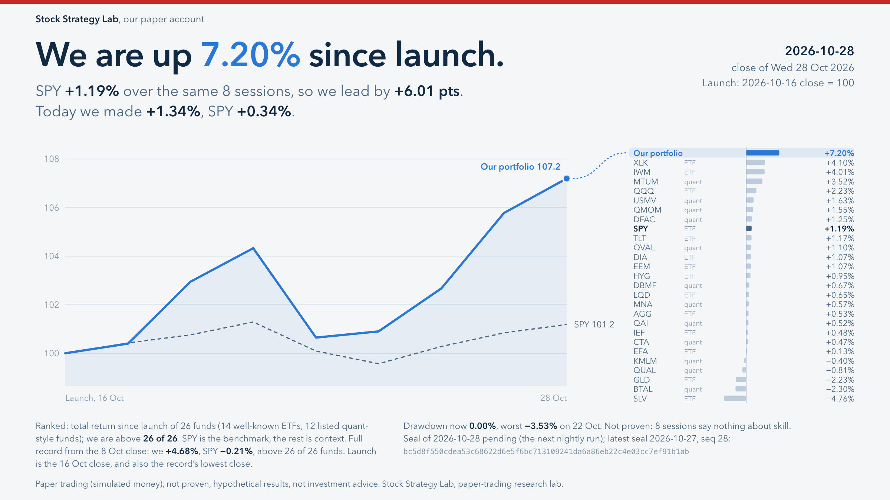

# Stock Strategy Lab: paper account record

**Paper trading (simulated money), not proven, hypothetical results, not investment advice.**

Stock Strategy Lab is a one-person research lab. Its strategies trade on a paper account: the orders are real
orders to a broker's simulator, but the money is not real. This repository publishes only the account's results.
It does not publish the strategy rules or the holdings.

## Latest

| Output | File |
|---|---|
| Daily card, 2026-10-28 | [PNG](cards/2026/card-2026-10-28.png), [PDF](cards/2026/card-2026-10-28.pdf) |
| Weekly report, week of 2026-10-26 (to 10-28) | [PDF](weekly/weekly-2026-10-26-2026-10-28.pdf) |
| Monthly report, October 2026 (to 10-28) | [PDF](monthly/monthly-2026-10.pdf) |
| Full record, 2026-10-16 to 2026-10-28 | [PDF](record/record-2026-10-16-to-2026-10-28.pdf) |

## How to read it

- **Launch** is the 2026-10-16 close = 100, the day the current design started. The full record from the
  2026-10-08 close is shown next to it on every output. The launch close is also the record's lowest close
  so far; the full-record line is there so this choice hides nothing.
- **Benchmark:** SPY, with dividends reinvested. The other 26 funds (14 well-known ETFs and 12 listed
  quant-style funds) are context only.
- **Returns** are the account's own daily close valuations, after all trading costs the account paid.
- **Seals:** every session's numbers are hashed into a tamper-evident daily chain (SHA-256) in the lab's
  private repository. Each output prints the chain hash of its latest sealed session. A hash shows that a
  number was fixed on that date; it can be checked once the chain itself is shown.
- **Not proven:** a few weeks of results say nothing about skill. Expect losing days, weeks and months.

## Cadence

- A daily card after each trading day's close.
- A weekly PDF after the last session of each week.
- A monthly PDF, with more detail, after each month end.

Files are added, never rewritten. A correction, if one is needed, is a new file with a note.
